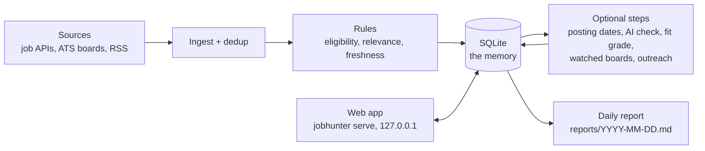

# jobhunter

[](https://github.com/mohamad-shoumar/job-hunter/actions/workflows/ci.yml)

jobhunter finds newly posted remote software and AI jobs that can hire someone living in one specific
country, here Lebanon. Finding jobs is easy; the hard part is **eligibility**. Most postings just say
"Remote", and many of those quietly mean "Remote, US only". So jobhunter reads about 20 sources every day,
judges every posting with plain rules that quote their evidence, and writes a daily report of the jobs you
have not seen yet. A local web app on the same database helps with the next steps: who to email, a tailored
CV, sending, and tracking replies.

It is built for one person and runs on a laptop. The interesting part is how it keeps rules and language
models honest: every verdict quotes its source, and a model's output changes a job's status, or reaches a
CV, letter or email, only after code has checked it.

## What a report looks like

Each job comes with the reason for its status, quoted from the posting (made-up example):

```markdown
### 2. Backend Engineer (Python) — Acme
- **Can hire from Lebanon:** likely — Region includes Lebanon: "EMEA"
- **Fit:** 12 · Title matches "backend"; Python stack · python, fastapi, postgresql, aws
- **Details:** remote · full-time · 3+ yrs · posted 2026-10-21 · found 2026-10-26

## Rejected (441)
| # | job | company | why |
| --- | --- | --- | --- |
| 41 | Software Engineer | Globex | Offers a 401(k), a US-only retirement plan, so it hires in the US: "retirement savings plan (401K plan etc.)" |
| 7 | Senior Python Developer | Initech | Asks for 10+ years of experience: "10+ years of professional software development experience" |
| 350 | Platform Engineer | Umbrella | Description limits location: "Remote within Europe, with candidates located within three hours of Central European Time" |
```

## How it works



1. **Fetch.** Each source adapter turns one site into the same `Job` shape. One broken board or posting
   becomes an error line, not a failed run.
2. **Dedup.** The same job on three sites becomes one row, with every sighting kept.
3. **Rules.** Plain code gives each new job one status (shortlisted, needs review, visa list, rejected) and
   the quote it rests on. Rejected jobs stay stored, so they never come back as "new".
4. **Optional steps.** Models look only at what the rules could not settle, and code checks what they say.
   The fit grade only sorts. Each step can fail without stopping the run.
5. **Report.** Each day's Markdown file is rebuilt from the database, so a rule change can redo any day.

| area | modules | what it owns |
| --- | --- | --- |
| One run | `pipeline.py`, `cli.py` | fetch, store, classify, the optional steps, the reports (`RunOptions`) |
| Sources | `sources/` | one adapter per site; `BoardSource` for per-company careers boards, `parse_each` so one bad posting costs only itself |
| Rules | `classify.py`, `eligibility.py`, `geo.py`, `relevance.py`, `extract.py`, `agency.py`, `relocation.py`, `visa.py` | the status and its quoted reason |
| Memory | `store/` | every SQL statement: the schema with numbered migrations, one module per group of tables |
| Model helpers | `llm.py`, `grounding.py`, `profile.py` | one JSON answer from DeepSeek, Claude or the Claude Code CLI; `find_quote`; the shared fact checks; reading the profile |
| Model steps | `ai_check.py`, `posted_date.py`, `fitgrade.py` | the AI eligibility check, posting dates, the fit grade |
| Writing | `cv.py`, `cover.py`, `pitch.py` | a tailored CV, a cover letter, a cold email, each line checked against the profile |
| Outreach | `contacts.py`, `hunter.py`, `mailer.py`, `tracking.py`, `outreach.py` | who to email, Gmail sending and reading, stages and follow-ups |
| Web app | `web/` | a FastAPI JSON API and one page, locked to your own browser |
| Output | `report.py`, `boards.py` | the daily report; company boards watched after a job there is shortlisted |

## Design decisions

The full reasoning, with dates and trade-offs, is in [docs/decisions.md](docs/decisions.md).

- **Rules decide, and quote their evidence.** Every verdict carries the words it rests on
  (`Restricted to "Remote - US"`), and a model only sees jobs the rules marked unclear.
  ([decision 1](docs/decisions.md#1-plain-rules-decide-a-model-only-looks-at-unclear-jobs-and-only-a-quote-code-can-find-counts))
- **A model's answer counts only when code finds its quote.** The AI check must return an exact quote and
  its page; `llm.find_quote` looks for it word for word in text that code fetched itself. A quote only the
  model saw changes nothing.
  ([decision 1](docs/decisions.md#1-plain-rules-decide-a-model-only-looks-at-unclear-jobs-and-only-a-quote-code-can-find-counts), [decision 10](docs/decisions.md#10-deepseek-and-the-claude-code-cli-instead-of-the-paid-anthropic-api))
- **Generated text cannot claim more than the profile.** CV bullets, cover-letter sentences and email lines
  pass the same checks (`grounding.py`): every number, tool, name and seniority word must be in the profile
  facts the line cites. A line that fails is sent back once, then replaced by the profile's own words or
  dropped. ([decision 11](docs/decisions.md#11-tailored-cvs-the-model-picks-order-and-wording-code-owns-the-facts))
- **Clicking Send twice cannot send twice.** The email is saved as `sending` before the network call, and a
  partial unique index on (job, step) refuses a second one. If Gmail refuses, the app says "Not sent". If
  the answer is lost, the send stays unsure ("Gmail did not confirm") until the next inbox check looks for
  its Message-ID.
  ([decision 13](docs/decisions.md#13-emails-go-out-only-when-i-click-send-and-a-second-click-cannot-send-twice))
- **One job, many sites.** Three keys, strongest first: the same listing id, the same ATS posting id in any
  link, or the same company and title within 60 days, unless their ATS ids differ.
  ([decision 3](docs/decisions.md#3-the-same-job-on-several-sites-three-keys-strongest-first))
- **The web app answers only your own browser.** It listens on 127.0.0.1, checks the Host header (against
  DNS rebinding), needs a startup token and a JSON body on every change, and sends no CORS headers.
  ([decision 15](docs/decisions.md#15-the-web-app-only-answers-my-own-browser))

## Try it

This run needs no API keys and no setup files: two public sources, the rules, and a report.

```sh
git clone https://github.com/mohamad-shoumar/job-hunter.git && cd job-hunter
python3 -m venv .venv && .venv/bin/pip install -e ".[web]"     # Python 3.11+
.venv/bin/jobhunter run --sources himalayas,remoteok --no-ai --no-outreach
open reports/$(date +%F).md      # macOS; any Markdown viewer works
.venv/bin/jobhunter serve         # the web app, http://127.0.0.1:8765
```

On 2026-10-26 that first run judged 501 new jobs: 7 shortlisted, 53 to review and 441 rejected, each with
its reason. `jobhunter show <id>` prints everything about one job.

Everything else is optional. Settings live in `config/*.json` (sources, rules, models, outreach) and keys in
`.env` (copy `.env.example`). With `DEEPSEEK_API_KEY` and the Claude Code CLI, the AI check, fit grade,
tailored CVs and cover letters turn on; Hunter and Gmail turn on outreach. For your own CVs and emails, copy
`profile/master_profile.example.md` and `resume/resume.example.md` (both made up) and fill them in. The
[manual](docs/usage.md) covers setup, every command and the daily schedule.

## Testing

```sh
.venv/bin/pip install -e ".[dev]"
.venv/bin/pytest          # 660 tests, about 5 seconds
.venv/bin/ruff check .
```

- **No network, no keys.** Source adapters run against trimmed real responses saved in `tests/fixtures/`
  (Greenhouse, Lever, Ashby, Himalayas, LinkedIn, SerpApi, Hunter, the sponsor registers, ...) through a
  fake HTTP client. Model calls go to fakes that return set answers. A fixture in `conftest.py` removes every
  API key and blocks the Claude Code CLI, so no test can reach Hunter, Claude, DeepSeek or Gmail, even when
  your shell has the keys.
- **What they pin down:** each rule's verdict and quote, dedup, the fact checks on generated text, a schema
  migration from an old database (`tests/fixtures/schema_v0.sql`), the web app's token, Host and input
  checks, and the double-send guard.
- **CI** runs ruff and the tests on Python 3.11 and 3.12 for every push and pull request
  ([workflow](.github/workflows/ci.yml)).

## More

- [docs/usage.md](docs/usage.md): the full manual
- [docs/decisions.md](docs/decisions.md): the main design choices, why, and what they cost
- [CONTRIBUTING.md](CONTRIBUTING.md): setup for development, tests, commit style
- [LICENSE](LICENSE)
